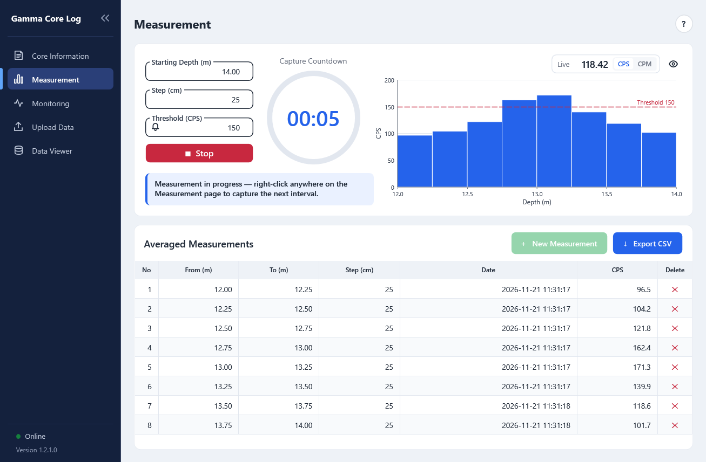
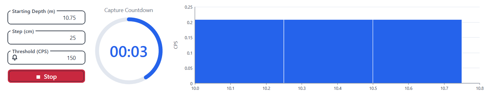
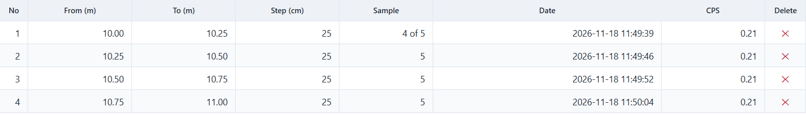
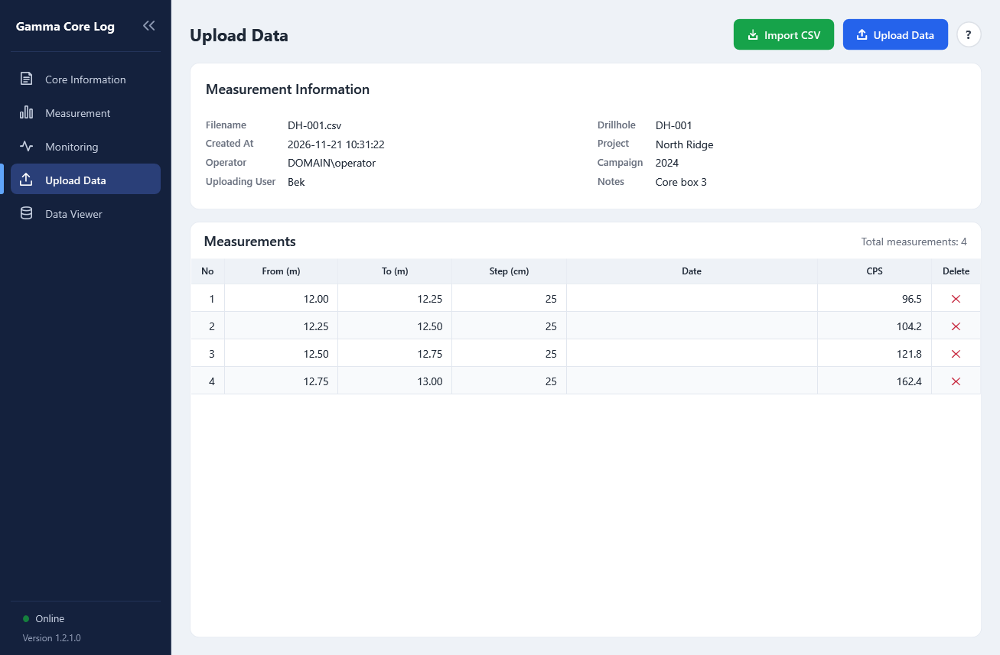
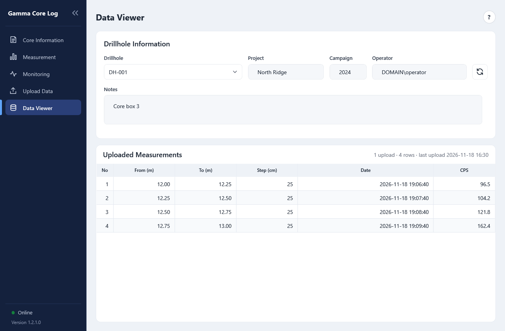
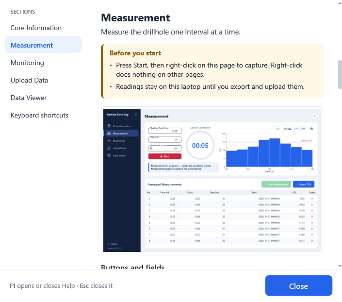

# Gamma Core Log — User Guide

Gamma Core Log logs CT007 gamma readings along a drillhole. You pick (or create) a drillhole, press **Start**, and
right-click once for every depth interval. Each capture averages the detector's readings over a few seconds and
becomes one row in the table. Readings stay on the laptop until you export them and upload them to the central
database.

The same guide as a Word file: [Gamma-Core-Log-User-Guide.docx](Gamma-Core-Log-User-Guide.docx).
Inside the app, press **F1** (or the **?** button at the top right of any page) for the Help window.

- [Before you start](#before-you-start)
- [Core Information](#core-information)
- [Creating a new drillhole](#creating-a-new-drillhole)
- [Measurement](#measurement)
- [Monitoring](#monitoring)
- [Upload Data](#upload-data)
- [Data Viewer](#data-viewer)
- [Help window and keyboard shortcuts](#help-window-and-keyboard-shortcuts)
- [When something goes wrong](#when-something-goes-wrong)

## Before you start

1. Switch on the CT007 probe and pair it with the laptop over Bluetooth. Any CT007 variant works: the app treats
   names such as `CT007-M`, `CT007-T` or `CT007-M-0001` as the same device family.
2. Open **GammaGuard** and connect the probe, so it starts writing readings.

   

3. Start **Gamma Core Log**. It opens on Core Information.

## Core Information

Pick the drillhole and check that the laptop is ready.

| Field / button | What it does |
|---|---|
| Drillhole | Type part of the Hole ID, then pick it (Enter, or click). Drillholes you already measured are listed first. |
| + New drillhole | Creates a drillhole that is not in the list (see below). |
| Project / Campaign | Filled in from the drillhole. |
| Operator / Notes | Your name (filled with your Windows account) and remarks. Saved with every reading. |
| Device Status | Green means ready. Red or amber says what needs fixing; **Retry** checks again. |
| Select / Change Database | Pick the GammaGuard database yourself if the app cannot find it. |
| Save & Continue | Saves the choice and opens the Measurement page. |

## Creating a new drillhole

Use this when the drillhole is not in the list yet (for example, a hole that has not reached the central collar list).

1. Click **+ New drillhole** under the Drillhole box.
2. Enter the **Drillhole ID**, **Campaign** and **Project**. All three are required.
3. Click **Save drillhole**.

If Campaign or Project is empty, the drillhole is **not** saved: the empty box turns red, a message under it says what
is missing, and an error message appears at the bottom of the window. An ID that already exists is refused too;
pick it from the list instead.

The new drillhole is stored on this laptop, added to the list and selected. It reaches the central database together
with its uploaded measurements. Existing drillholes can still be picked from the list as before.

## Measurement

Measure the drillhole one interval at a time.

1. Enter **Starting Depth (m)** and **Step (cm)**. Optionally set **Threshold (CPS)** for an alarm.
2. Press **Start**.
3. Lower the probe to the interval and **right-click anywhere on the Measurement page**. The countdown runs while the
   readings are collected (default 5 s; click the countdown to change it, 2–10 s).
4. When the countdown ends, a row is added and the starting depth moves on by one step. Right-click for the next one.
5. Press **Stop** when you are done.

 

**Right-click only captures on the Measurement page.** On every other page a right-click does nothing to the table,
and readings from the device are ignored. If you leave the Measurement page while a capture is running, that capture
is cancelled and nothing is saved; measuring stays switched on, so come back and right-click again.

| Item | What it does |
|---|---|
| Live | The boxed value above the graph, left of the eye icon: the newest reading from the detector, updated every second while you are on this page (— when there is no recent reading). **CPS / CPM** beside it switches the unit (CPM = CPS × 60); your choice is kept until you close the app. |
| Graph | One bar per interval: depth along the bottom, CPS up the side. |
| Threshold line | The alarm threshold drawn as a dashed red line across the graph, before, during and after measuring. The **eye icon** above the graph shows it (open eye) or hides it (crossed-out eye). |
| Bell | Alarm state. Red when the last reading was above the threshold; click to mute or unmute the sound. |
| Table | No, From, To, Step, Date and CPS of every interval. Click ✕ to delete a row (after confirming). |
| Export CSV | Saves the table as a file for the Upload Data page. (The file also contains the sample count of each capture.) |
| New Measurement | Closes this drillhole; enter the next one in Core Information. Saved data is kept. |

## Monitoring

Live readings from every detector connected in GammaGuard. **Take sample** skips the next reading and averages the
five after it. Click a detector row for its details.

## Upload Data

Send an exported CSV to the central database. This is the only way readings reach it, and you need to be online (green
dot in the sidebar).

1. Click **Import CSV** and choose the file exported from the Measurement page.
2. Check the rows; click ✕ to drop one.
3. Click **Upload Data**. Uploading the same file twice stores it once.

## Data Viewer

See what has been uploaded to the central database. Pick a drillhole to list its uploaded readings by depth;
**Refresh** loads the latest data.

## Help window and keyboard shortcuts

The Help window has one section per page, with a picture of the page, and opens at the section for the page you are
on. The list on the left jumps to any section. There is only ever one Help window: pressing **?** while it is open
brings it to the front.

| Keys | What it does |
|---|---|
| F1 | Opens Help at the page you are on, or closes it. Works on every page, whatever has the keyboard focus, and inside Help. |
| Esc | Closes Help. |
| ? button | Opens Help, or brings it to the front if it is already open. |
| Right-click | Captures one interval — on the Measurement page only, after Start. |
| Enter / Esc | In the capture duration editor: save / cancel. |
| ↑ ↓ Enter | In the Drillhole box: move through the list and pick a drillhole. |

## When something goes wrong

| Problem | What to do |
|---|---|
| Device Status is red for Bluetooth | Check the probe is on and paired. Any CT007 name (CT007-M, CT007-T …) is accepted. |
| "No samples were received" after a capture | GammaGuard is not recording the probe. Check it in GammaGuard and try again. |
| Right-click does nothing | You are not on the Measurement page, or Start has not been pressed. |
| New drillhole is not saved | Fill in Drillhole ID, Campaign and Project; the red box shows what is missing. |
| Sidebar shows Offline | The backend cannot be reached. Measuring still works; upload later. |

Your measurements are stored per Windows user in `%LocalAppData%\CT007_Measurement_Studio\measurements.db`.
