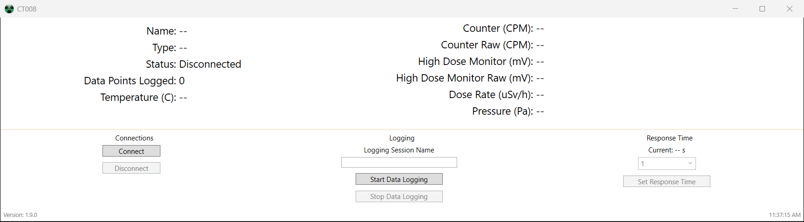
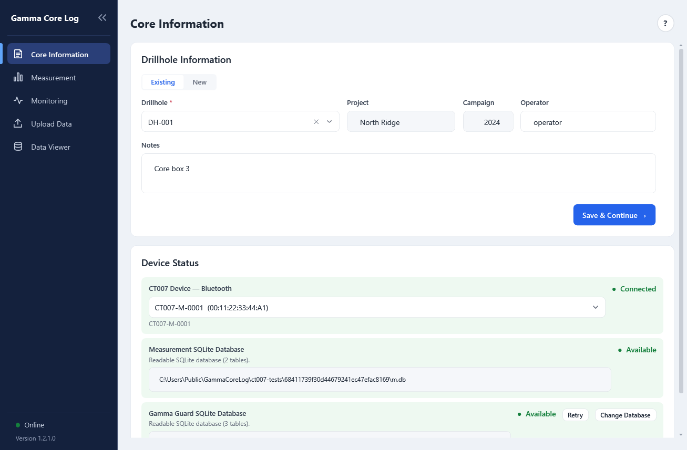
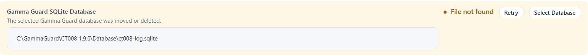
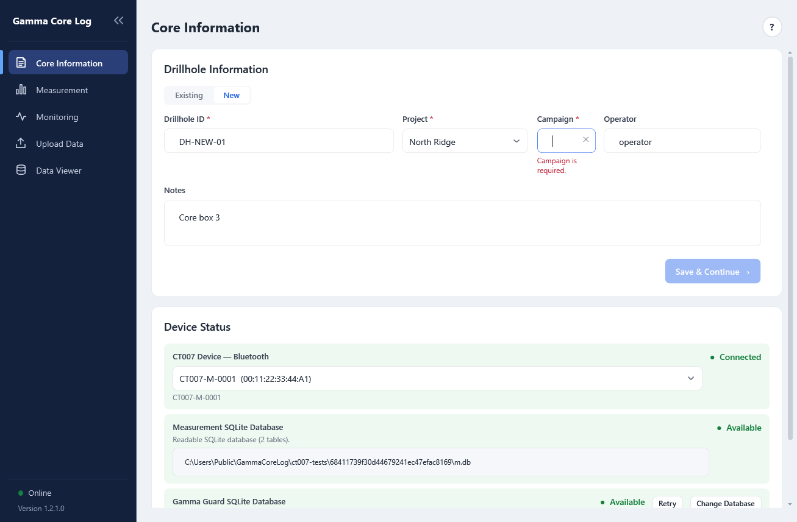
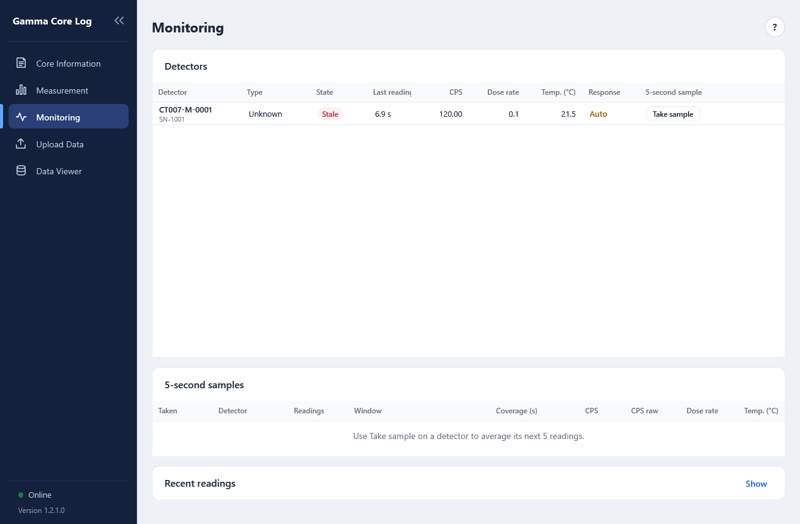
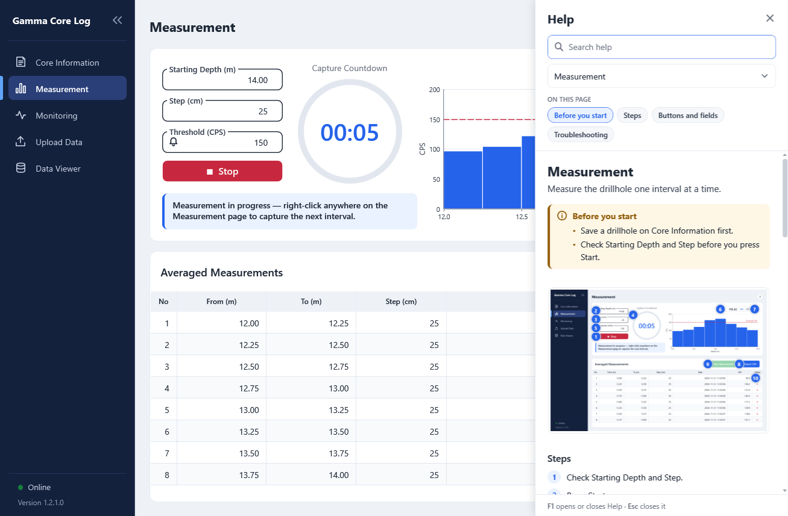

# Gamma Core Log — User Guide

Gamma Core Log logs CT007 gamma readings along a drillhole. You pick (or create) a drillhole, press **Start**, and
right-click once for every depth interval. Each capture averages the detector's readings over a few seconds and
becomes one row in the table. Readings stay on the laptop until you export them and upload them to the central
database.

The same guide as a Word file: [Gamma-Core-Log-User-Guide.docx](Gamma-Core-Log-User-Guide.docx).
Inside the app, press **F1** (or the **?** button at the top right of any page) to open Help at the page you are on.

- [Before you start](#before-you-start)
- [Core Information](#core-information)
- [Creating a new drillhole](#creating-a-new-drillhole)
- [Measurement](#measurement)
- [Monitoring](#monitoring)
- [Upload Data](#upload-data)
- [Data Viewer](#data-viewer)
- [Help and keyboard shortcuts](#help-and-keyboard-shortcuts)
- [When something goes wrong](#when-something-goes-wrong)

## Before you start

1. Switch on the CT007 probe and pair it with the laptop over Bluetooth. Any CT007 variant works: the app treats
   names such as `CT007-M`, `CT007-T` or `CT007-M-0001` as the same device family.
2. Open **GammaGuard** and connect the probe, so it starts writing readings.

   

3. Start **Gamma Core Log**. It opens on Core Information.

## Core Information

Pick the drillhole and check that the laptop is ready.

| Field / button | What it does |
|---|---|
| Existing / New | Existing picks a drillhole from the list. New creates one that is not in the list yet (see below). |
| Drillhole | Type part of the Hole ID, then pick it (Enter, or click). Drillholes you already measured are listed first; **Local** marks one created on this computer. |
| Project / Campaign | Filled in from the drillhole (chosen by you in New). |
| Operator / Notes | Your name (filled with your Windows account) and remarks. Saved with every reading. |
| Device Status | Green means ready. Red or amber says what needs fixing; **Retry** checks again. |
| Select / Change Database | Pick the GammaGuard database yourself if the app cannot find it. |
| Save & Continue | The only save button. Saves the choice (in New: creates the drillhole first) and opens the Measurement page. |

## Creating a new drillhole

Use this when the drillhole is not in the list yet (for example, a hole that has not reached the central collar list).

1. Click **New** in the Existing / New switch above the Drillhole box. Any drillhole you had picked is cleared.
2. Type the **Drillhole ID**.
3. Pick the **Project** and the **Campaign** from their lists. If yours is not there, choose **+ Add new project** (or
   **+ Add new campaign**) and type it; the **×** goes back to the list.
4. Click **Save & Continue**. The drillhole is created, selected and the Measurement page opens, all in one step.

Drillhole ID, Project and Campaign are all required. **Save & Continue** stays disabled until they are filled in, and
an empty box shows what is missing. Spaces at the start and end are removed.

If the Drillhole ID already exists (in any letter case), the app says so: click **switch to Existing to select it** to
pick that drillhole instead. A new Project or Campaign that already exists in another letter case (for example
`zoovch` next to `Zoovch`) is refused too; pick it from the list.

The new drillhole is stored on this computer only, also when the app is offline, and is never sent to the central
drillhole list. It is listed with a **Local** tag and is still there after a restart. Its new Project or Campaign is
offered in the lists straight away.

Switching back to Existing with something typed asks **Discard new drillhole?** first: **Discard** drops it, **Keep
editing** stays in New.

## Measurement

Measure the drillhole one interval at a time.

1. Enter **Starting Depth (m)** and **Step (cm)**. Optionally set **Threshold (CPS)** for an alarm.
2. Press **Start**.
3. Lower the probe to the interval and **right-click anywhere on the Measurement page**. The countdown runs while the
   readings are collected (default 5 s; click the countdown to change it, 2–10 s).
4. When the countdown ends, a row is added and the starting depth moves on by one step. Right-click for the next one.
5. Press **Stop** when you are done.

 

**Right-click only captures on the Measurement page.** On every other page a right-click does nothing to the table,
and readings from the device are ignored. If you leave the Measurement page while a capture is running, that capture
is cancelled and nothing is saved; measuring stays switched on, so come back and right-click again.

| Item | What it does |
|---|---|
| Live | The boxed value above the graph, left of the eye icon: the newest reading from the detector, updated every second while you are on this page (— when there is no recent reading). **CPS / CPM** beside it switches the unit (CPM = CPS × 60); your choice is kept until you close the app. |
| Graph | One bar per interval: depth along the bottom, CPS up the side. |
| Threshold line | The alarm threshold drawn as a dashed red line across the graph, before, during and after measuring. The **eye icon** above the graph shows it (open eye) or hides it (crossed-out eye). |
| Bell | Alarm state. Red when the last reading was above the threshold; click to mute or unmute the sound. |
| Table | No, From, To, Step, Date and CPS of every interval. Click ✕ to delete a row (after confirming). |
| Export CSV | Saves the table as a file for the Upload Data page. (The file also contains the sample count of each capture.) |
| New Measurement | Closes this drillhole; enter the next one in Core Information. Saved data is kept. |

## Monitoring

Live readings from every detector connected in GammaGuard. **Take sample** skips the next reading and averages the
five after it. Click a detector row for its details.

## Upload Data

Send an exported CSV to the central database. This is the only way readings reach it, and you need to be online (green
dot in the sidebar).

1. Click **Import CSV** and choose the file exported from the Measurement page.
2. Check the rows; click ✕ to drop one.
3. Click **Upload Data**. Uploading the same file twice stores it once.

## Data Viewer

See what has been uploaded to the central database. Pick a drillhole to list its uploaded readings by depth;
**Refresh** loads the latest data.

## Help and keyboard shortcuts

Help slides in from the right edge of the window and opens at the page you are on; it follows you when you change
page. Each page's help has the same parts: what the page is for, **Before you start**, a picture with numbered markers,
**Steps**, **Buttons and fields** (the numbers match the markers) and **Troubleshooting**. Search finds text on every
page, the page list at the top switches page, and the **On this page** links jump to a part. Click the picture to see
it larger. Drag Help's left edge to make it wider; the width is remembered. The app has no tooltips: what each field
and button does is in **Buttons and fields**, and the **Keyboard shortcuts** entry also lists the controls found on
every page (sidebar, header and Help itself).

On the Measurement page Help does not dim the page or close when you click outside it, so you can keep measuring with
Help open: right-click on the page still captures (right-click inside Help does not).

| Keys | What it does |
|---|---|
| F1 | Opens Help at the page you are on, or closes it. Works on every page, whatever has the keyboard focus. |
| ? button | Opens or closes Help, like F1. It is highlighted while Help is open. |
| Esc | Closes an enlarged picture, then Help. |
| Ctrl+F | While Help is open: jumps to its search box. |
| Right-click | Captures one interval — on the Measurement page only, after Start, and not inside Help. |
| Enter / Esc | In the capture duration editor: save / cancel. |
| ↑ ↓ Enter | In the Drillhole box: move through the list and pick a drillhole. |

## When something goes wrong

| Problem | What to do |
|---|---|
| Device Status is red for Bluetooth | Check the probe is on and paired. Any CT007 name (CT007-M, CT007-T …) is accepted. |
| "No samples were received" after a capture | GammaGuard is not recording the probe. Check it in GammaGuard and try again. |
| Right-click does nothing | You are not on the Measurement page, or Start has not been pressed. |
| Save & Continue is greyed out in New | Fill in Drillhole ID, Project and Campaign; the red box shows what is missing or already exists. |
| Sidebar shows Offline | The backend cannot be reached. Measuring still works; upload later. |

Your measurements are stored per Windows user in `%LocalAppData%\CT007_Measurement_Studio\measurements.db`.
